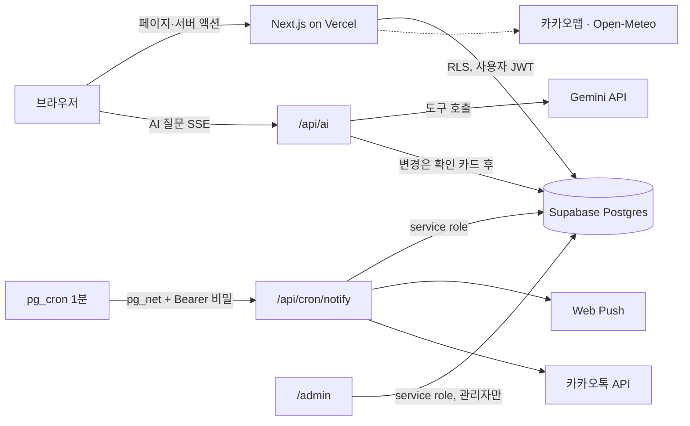
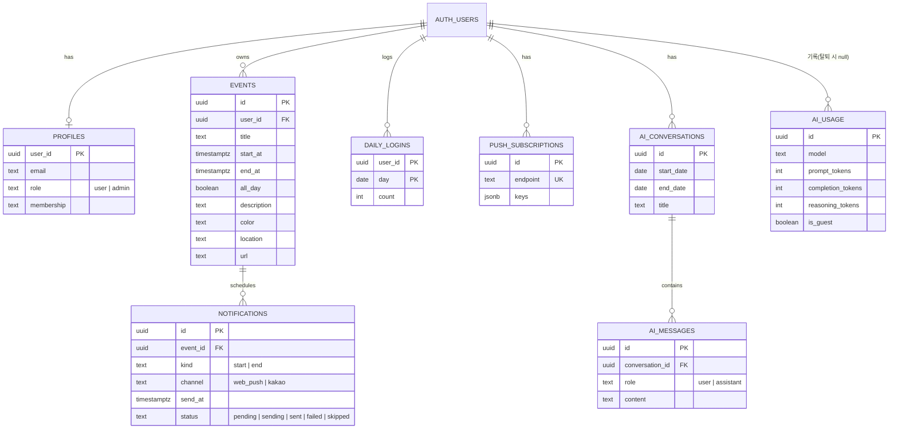

# 📅 my-calendar

> 월간·주간 캘린더에서 일정을 관리하고, **AI에게 말로 일정을 추가·수정·삭제**하며, 시작 전에 **웹 푸시·카카오톡 알림**을 받는 한국어 캘린더 웹앱

- 운영 주소: <https://my-calendar.jhsong.dev>
- 개발 기간: 2026-10-25 ~ (운영 배포 2026-10-29)

---

## 📌 1. 프로젝트 소개

### 주제 선정 배경
일정 앱은 입력이 번거롭고, 알림을 받으려면 앱을 따로 설치해야 합니다. "내일 오후 3시에 치과 잡아줘"처럼 말로 입력하고, 이미 쓰는 **카카오톡·브라우저 푸시**로 알림을 받으면 이 두 가지가 줄어든다고 생각했습니다. 또 단순 기능 구현에서 끝내지 않고 **배포 → 운영 → 비용·보안 관리**까지 직접 경험하는 것을 목표로 했습니다.

### 주요 사항
- **일정 관리:** 월간·주간 화면, 날짜 칸을 끌어 기간 일정 생성, 막대를 끌어 이동·양 끝 늘이기, 장소(카카오맵)·링크, 날짜별 날씨(Open-Meteo)
- **AI 대화:** Gemini 도구 호출로 검색·추가·수정·삭제. **변경은 반드시 확인 카드를 거쳐 실행**
- **알림:** 일정 시작·종료 전 알림 예약(DB 트리거) → 1분 워커가 Web Push·카카오톡 "나에게 보내기"로 발송
- **사용자 인증:** 이메일·Google·**게스트(익명) 로그인**, 비밀번호 재설정, 계정 삭제, CAPTCHA(Turnstile)
- **비용 통제:** 사용자별 질문 횟수 제한 + 관리자가 정하는 **사용자당 하루 사용 금액 한도**(질문 1건 평균 약 1.8원, 모델 `gemini-3.5-flash-lite`, 13건 시험 기준)
- **관리자(`/admin`):** 가입·활동, AI 사용량/비용, 알림 발송, 사용자 목록, 정리 작업 현황
- **다국어:** 한국어·영어

### 핵심 성과·개선 포인트
| 구분 | 내용 |
| --- | --- |
| 안정성 | 알림 워커가 행을 선점(`sending`)해 **중복 발송 방지**, 만료 알림은 `skipped(expired)`로 처리, 일정 수 상한 트리거, 입력 서버 재검증 |
| 보안 | 모든 사용자 데이터 **RLS**로 본인 행만 접근, 카카오 토큰 암호화 저장, 빈도 제한, 보안 헤더 5종 |
| 운영 편의 | 관리자 대시보드로 비용·지연된 알림·정리 작업 상태를 한 화면에서 확인 |
| 비용 | 토큰 사용량 기록(`ai_usage`)과 금액 한도로 AI 지출 상한 관리 |

> 응답 시간 같은 성능 수치는 따로 측정하지 않았습니다. 위 표에는 실제로 확인한 항목만 적었습니다.

### 담당 역할
개인 프로젝트로 기획(PRD)·DB 설계·프론트/백엔드·인프라(Vercel, Supabase, Cloudflare, Resend)·배포·운영 점검을 혼자 맡았습니다. 구현에는 AI 코딩 도구(Claude Code)를 보조로 사용했고, 요구사항 결정과 검증, 계정 권한이 필요한 외부 콘솔 설정은 직접 했습니다.

### 관련 문서
- 요구사항 [`docs/PRD.md`](docs/PRD.md) · 개발 계획 [`docs/ROADMAP.md`](docs/ROADMAP.md)
- 인수인계(현재 상태·결정·함정) [`docs/HANDOFF.md`](docs/HANDOFF.md)
- 검증 기록 [`docs/calendar-verification.md`](docs/calendar-verification.md) · AI 보안 [`docs/ai-security.md`](docs/ai-security.md)

---

## 📌 2. 기술 스택

| 영역 | 기술 |
| --- | --- |
| Frontend | Next.js 16 (App Router, `cacheComponents`), React 19, TypeScript (strict), Tailwind CSS v4, shadcn/ui (`@base-ui/react`), lucide-react |
| Backend | Next.js Server Actions · Route Handlers, Supabase (Postgres, Auth, RLS, Vault) |
| AI | Google Gemini API (`gemini-3.5-flash-lite`, 스트리밍 SSE, 도구 호출) |
| 알림 | Web Push (VAPID), 카카오톡 메시지 API, 서비스 워커 |
| 스케줄 | Supabase `pg_cron` + `pg_net` |
| 외부 연동 | 카카오맵 JS SDK, Open-Meteo, Resend(SMTP), Cloudflare Turnstile |
| 배포 | Vercel (GitHub `main` 푸시 시 자동 배포), Cloudflare(도메인·DNS) |

### 선택 이유
- **Next.js:** 서버 컴포넌트·서버 액션으로 별도 API 계층을 줄이고 Vercel과 궁합이 좋습니다.
- **TypeScript strict:** 날짜·기간 계산처럼 틀리기 쉬운 로직을 컴파일 단계에서 잡고, 한국어/영어 사전도 타입으로 키 불일치를 검출합니다.
- **Supabase:** 사용자별 데이터 분리를 **DB 정책(RLS)** 으로 강제할 수 있고, 이메일·Google·익명 로그인을 한 곳에서 지원합니다.
- **Gemini:** 도구 호출과 스트리밍을 지원하고 토큰 단가가 낮아 개인 서비스 비용에 맞습니다.
- **pg_cron:** Vercel Hobby의 Cron은 하루 1회라 1분 단위 알림에 부족해, DB가 워커 URL을 1분마다 호출하도록 했습니다.
- **카카오맵/카카오톡:** 한국 주소·가게 검색 정확도와 한국 사용자의 메신저 사용 습관을 고려했습니다.

---

## 📌 3. 아키텍처



**요청 흐름과 접근 제어**
`proxy.ts`가 세션을 갱신하고, `/api/*`는 비로그인이면 401, `/admin`은 관리자만 통과시킵니다(운영에서는 경로 존재를 숨기려 404로 응답). 서버 액션은 매번 `requireUser()`로 로그인을 확인하고 입력을 다시 검증합니다.

**알림 파이프라인**
일정을 저장하면 DB 트리거가 `notifications` 행(시작/종료 × 채널)을 예약합니다. `pg_cron`이 1분마다 워커를 호출하면 워커는 발송 시각이 된 행을 `sending`으로 선점한 뒤 채널별로 보내고 결과를 `sent`/`failed`/`skipped`로 닫습니다. 워커는 `CRON_SECRET`으로 보호되고, 비밀값은 코드가 아니라 Vault에 둡니다.

**AI 대화의 안전장치**
AI는 일정을 직접 바꾸지 못하고 "초안"만 만듭니다. 사용자가 확인 카드에서 승인하면 그때 서버가 사용자 권한으로 실행합니다. 질문 전에 금액 한도와 횟수 한도를 확인하고, 질문 후 토큰 사용량을 기록합니다.

**관리자 영역**
일반 앱과 분리된 두 번째 루트 레이아웃입니다. 접근은 proxy와 페이지·액션에서 이중으로 확인하고, 통계는 DB 함수 없이 서버 코드가 service role로 집계합니다.

**배치**
`notify-due`(1분마다 발송 워커 호출), `purge-daily`(매일 03:00 KST에 만료 AI 대화·게스트·알림 정리). 정의는 [`supabase/cron/schedule.sql`](supabase/cron/schedule.sql).

---

## 📌 4. API 명세서

화면 이동은 제외하고 데이터를 읽고 쓰는 진입점만 정리했습니다. "권한"의 `로그인`은 본인 데이터만, `관리자`는 `profiles.role='admin'`, `비밀`은 서버 간 비밀값 인증입니다.

### 4-1. Route Handler

| 기능 | Method | 경로 | 권한 |
| --- | --- | --- | --- |
| AI 질문(SSE 스트리밍) | POST | `/api/ai` | 로그인 |
| 알림 발송 워커 | POST | `/api/cron/notify` | 비밀(`CRON_SECRET`) |
| 로그인 확인·OAuth 콜백 | GET | `/auth/callback` | 공개 |
| 카카오 연결 시작 | GET | `/auth/kakao/connect` | 로그인(게스트 제외) |
| 카카오 연결 콜백 | GET | `/auth/kakao/callback` | 로그인 |

### 4-2. Server Action

| 도메인 | 기능 | 함수 | 권한 |
| --- | --- | --- | --- |
| 일정 | 생성·수정·이동·삭제 | `createEvent` · `updateEvent` · `moveEvent` · `deleteEvent` | 로그인 |
| AI | 최근 대화 불러오기 / 전체 삭제 / 오늘 사용량 비율 | `loadLatestConversation` · `deleteAllConversations` · `getUsageStatus` | 로그인 |
| 푸시 | 구독 / 해제 / 끄기 / 테스트 | `subscribePush` · `unsubscribePush` · `disablePush` · `sendTestPush` | 로그인 |
| 관리자 | AI 요금 단가 저장 / 사용 금액 한도 저장 | `savePricing` · `saveCostLimit` | 관리자 |

### 4-3. 관리자 화면

| 경로 | 내용 |
| --- | --- |
| `/admin` | 환경 점검, 구현 예정 기능 |
| `/admin/dashboard` | 가입·활동, AI 사용량/비용, 알림 발송, 사용 금액 한도 슬라이더 |
| `/admin/users` | 사용자 목록(필터·정렬·검색) |
| `/admin/cleanup` | 만료 데이터 정리 현황 |

---

## 📌 5. ERD 설계

사용자는 Supabase `auth.users`를 기준으로 하고, 모든 사용자 데이터 테이블은 `user_id`로 연결되어 계정 삭제 시 함께 지워집니다(`on delete cascade`). 일부 보조 테이블(`ai_requests`, `action_requests`, `kakao_tokens`)과 인증 테이블은 생략했습니다.



그 밖에 관리자 설정 저장용 `app_settings(key, value)`가 있습니다(AI 요금 단가, 사용 금액 한도). 스키마 전체는 [`supabase/migrations/`](supabase/migrations/)의 마이그레이션 16개로 관리합니다.

---

## 📌 6. UI

#### 로그인


이메일·Google 로그인, 가입 없이 쓰는 **게스트 시작**, Turnstile CAPTCHA.

#### 월간 캘린더


여러 날 일정은 사선 무늬 막대로 표시하고, 날짜 옆에 날씨 아이콘이 붙습니다. 칸이 차면 "N개 더 보기"로 펼칩니다.

#### AI 대화


"내일 3시에 과외일정을 추가해주세요" → AI가 **일정 초안 카드**를 만들고, 사용자가 `추가`를 눌러야 저장됩니다. 맨 위에는 오늘 AI 사용량(한도 대비 %)이 보입니다.

#### 주간 일정


시간 단위 블록을 끌어 이동하고 가장자리를 끌어 길이를 조절합니다. 요일 머리글에 날씨와 기온이 표시됩니다.

#### 일정 수정 (장소·지도)


제목·시간·색상·장소·링크·설명. 장소를 입력하면 카카오맵이 표시됩니다.

#### 관리자 대시보드


사용자당 하루 AI 사용 금액 한도(슬라이더)와 가입·로그인·AI·알림 통계.

#### 관리자 사용자 목록


이메일은 일부만 가리고(마스킹) 일정은 개수만 보여 줍니다.

---

## 📌 7. 트러블슈팅

### 1) 1분 알림 스케줄러가 실제로는 돌지 않고 있었음
- **증상:** 발송 시각이 지난 알림이 `pending`으로 남음. `curl`로 워커를 직접 부를 때만 발송됨.
- **원인:** DB에 `pg_cron`·`pg_net` 확장과 Vault 비밀값이 없었음(읽기 전용 조회로 발견).
- **해결:** 확장 활성화 후 `schedule.sql` 실행. 처음엔 SQL의 `<배포한 도메인>` 자리표시자를 바꾸지 않아 `invalid URL`로 실패 → `vault.update_secret`으로 수정하고 `cron.job_run_details`와 워커 응답(HTTP 200)으로 확인. 밀려 있던 알림은 `skipped(expired)`로 안전하게 처리됨.
- **교훈:** "설정 완료"를 문서로만 믿지 않고 **조회로 검증**한다.

### 2) AI 토큰 사용량이 실제보다 부풀려 기록됨
- **증상:** 한 질문의 `usage_rounds`가 모델 호출 수보다 큼.
- **원인:** 스트리밍 응답에서 사용량이 **누적값으로 반복**해서 오는데 매번 더했음.
- **해결:** 호출마다 **마지막 값만** 합산, `stream_options.include_usage` 활성화. 질문 시험 세트 13건에서 누락 0 확인.

### 3) Next 16 `cacheComponents`에서 현재 시각을 읽으면 빌드 오류
- **증상:** 설정 페이지에서 `blocking-prerender-current-time`.
- **원인:** 사전 렌더링 중에 현재 시각·세션을 읽는 서버 코드.
- **해결:** `await connection()`을 먼저 호출하고 `<Suspense>` 안에서 실행.

### 4) 끄는 중 포인터를 놓쳐 버튼이 멈춤
- **원인:** 임계값(5px)을 넘은 뒤에야 포인터를 붙잡아, 빠르게 끌면 움직임을 놓침.
- **해결:** 누르는 순간 `setPointerCapture`로 붙잡고, 5px 미만은 클릭으로 처리.

### 5) 모바일 일정 수정 시트에서 저장 버튼이 화면 밖으로 밀림
- **원인:** 저장 줄이 스크롤 내용의 맨 아래에 있었고, AI 버튼이 입력칸을 덮음.
- **해결:** 저장·삭제 줄을 스크롤 영역 밖 고정 푸터로 분리, 수정 창이 열리면 CSS(`body:has(...)`)로 AI 버튼 숨김.

### 6) 깨진 인코딩 경로(`/day/%ZZ`)에서 500
- **원인:** 잘못된 날짜 경로를 `rewrite`로 404 처리하면서 디코딩에 실패한 경로까지 건드림.
- **해결:** 인코딩이 깨진 경로는 건드리지 않고 그대로 통과.

### 7) 개발·운영이 같은 Supabase를 공유
- **영향:** 시험 데이터가 운영과 섞이고, 마이그레이션 전에 새 코드가 배포되면 조회가 실패.
- **대응:** "마이그레이션 먼저 적용 → 푸시" 순서를 문서화하고 운영에 시험 계정을 만들지 않음. 분리는 후속 과제.

---

## 📌 8. 회고

### 배운 점
- 보안은 앱 코드보다 **DB 정책(RLS)과 서버 재검증**에 두는 편이 단순하고 안전합니다.
- AI 비용, 메일 발송 한도, Vercel Cron 제한 같은 **외부 서비스의 한도가 설계를 결정**합니다.
- 확인한 것과 확인하지 못한 것을 구분해 기록(`calendar-verification.md`, `HANDOFF.md`)하니 긴 작업도 이어받기 쉬웠습니다.

### 다시 한다면
- 개발·운영 DB를 처음부터 분리합니다.
- 테스트 러너(단위·E2E)를 초기에 도입합니다. 지금은 `tsc`·`lint`·`build`, 임시 스크립트, 헤드리스 브라우저 확인에 의존합니다.
- 알림 스케줄러처럼 외부 설정이 필요한 항목은 **배포 체크리스트와 상태 점검 화면**을 먼저 만듭니다.
- DB 백업(Free 플랜은 자동 백업 없음), 오류 모니터링, CSP를 초기에 계획합니다.

### 남은 과제
다른 카카오 계정 동의 시험, 개인정보처리방침 전문가 검토, 관리자 기능 확장(오류 모음·공지·문의함 등), 공개 소개/체험 페이지.

---

## 🚀 시작하기

```bash
npm install
cp .env.example .env   # 값은 직접 채웁니다(Supabase, Gemini, VAPID, 카카오 등)
npm run dev            # http://localhost:3000
npm run build          # 프로덕션 빌드
npm run lint           # ESLint
```

DB는 `supabase/migrations/`를 순서대로 적용하고, 알림 스케줄은 배포 후 `supabase/cron/schedule.sql`을 한 번 실행합니다.
